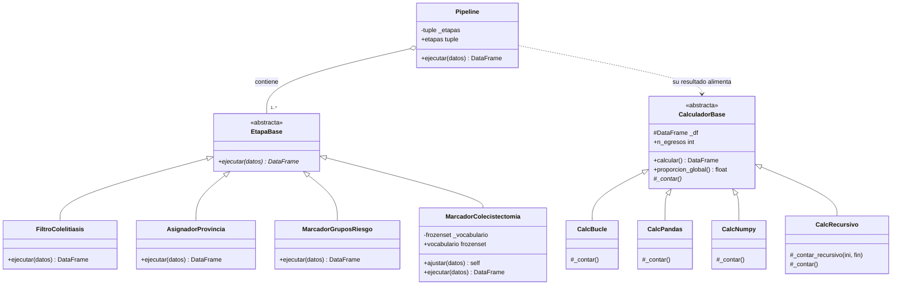

# Arquitectura del núcleo de F3

## Diagrama de clases

## Cómo leer el diagrama

- **Herencia:** las cuatro clases de etapa heredan de `EtapaBase`, lo que las obliga a implementar el método `ejecutar`. Las cuatro estrategias heredan de `CalculadorBase` y reutilizan de ella la validación, el formato de la tabla y la proporción global.
- **Polimorfismo:** el `Pipeline` llama a `ejecutar` en cada etapa sin necesitar saber cuál es; cada una responde a su propia manera. Del mismo modo, las cuatro estrategias se usan con el mismo método, `calcular()`.
- **Encapsulamiento:** el `Pipeline` guarda sus etapas en el atributo interno `_etapas` y solo permite consultarlas mediante la propiedad `etapas`, no modificarlas. `CalculadorBase` valida los datos al crear el objeto y los guarda en `_df`. `MarcadorColecistectomia` guarda lo aprendido en `_vocabulario` y solo permite consultarlo mediante la propiedad `vocabulario`.
- **Patrón de diseño:** se aplica el patrón *Pipeline* (tubería). Cada etapa recibe la tabla, la transforma y la entrega a la siguiente. Para agregar un paso nuevo basta con crear otra clase que herede de `EtapaBase`, sin modificar las existentes. En los calculadores se aplican los patrones *Strategy* (estrategias intercambiables) y *Template Method* (`CalculadorBase` fija los pasos comunes y cada estrategia define cómo contar).
- **Clases que aprenden de los datos:** de las cuatro etapas, solo `MarcadorColecistectomia` aprende: en `ajustar()` guarda las glosas de colecistectomía presentes en los datos y en `ejecutar()` las aplica. Las otras tres aplican reglas fijas de la pregunta de investigación y se mantienen como clases por el patrón Pipeline.