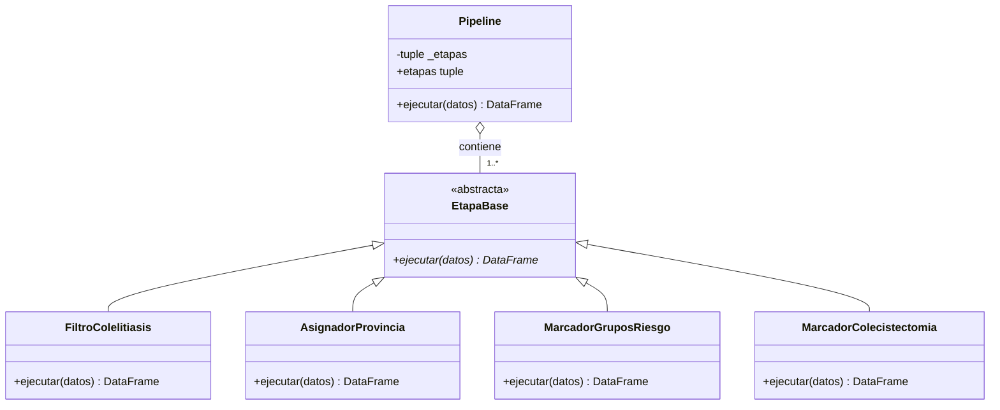

# Arquitectura del núcleo de F3

## Diagrama de clases

## Cómo leer el diagrama

- **Herencia:** las cuatro clases de etapa heredan de `EtapaBase`, lo que las obliga a implementar el método `ejecutar`.
- **Polimorfismo:** el `Pipeline` llama a `ejecutar` en cada etapa sin necesitar saber cuál es; cada una responde a su propia manera.
- **Encapsulamiento:** el `Pipeline` guarda sus etapas en el atributo interno `_etapas` y solo permite consultarlas mediante la propiedad `etapas`, no modificarlas.
- **Patrón de diseño:** se aplica el patrón *Pipeline* (tubería). Cada etapa recibe la tabla, la transforma y la entrega a la siguiente. Para agregar un paso nuevo basta con crear otra clase que herede de `EtapaBase`, sin modificar las existentes.
- 